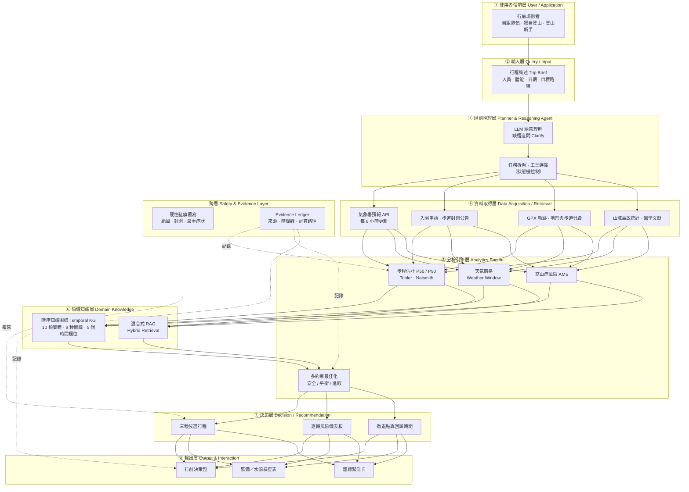
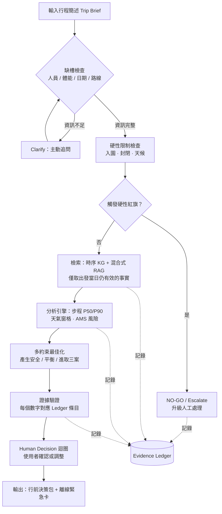

# TrailGuard TW ｜山徑守護者

> 以證據為基礎的臺灣高山行程規劃與風險決策支援代理人  
> An evidence-grounded trip-planning and risk-decision support agent for Taiwan's high mountains.


> **GitHub 儲存庫：** https://github.com/wilber830915/AIoT-DIC4-ICEIB2027.git  
> **Overleaf 專案：** https://www.overleaf.com/project/6b06bb69668f4d5869443455/share#d8cf67f41fb18e1b8c3588a30ba2ce674245dc27ed3a7234

---

## 專案簡介

**TrailGuard TW（山徑守護者）** 是一個「領域 AI 代理人（Domain AI Agent）」，針對臺灣高山行程規劃提供**有證據、可追溯、會說「不要去」**的行前決策支援。

它不是幫使用者決定要不要上山的「自動駕駛」，而是把證據攤開、把風險算清楚、把回頭條件寫明白的**副駕駛**。

本專案依課程規範採用 **AI Agent + Domain Knowledge + Data Analytics + Real-World Application** 的組合，而非單一模型或聊天機器人：

| 組成 | 本專案的實踐 |
|------|-------------|
| AI Agent | LLM 負責語意理解、缺槽追問、結果解釋；規劃與工具選擇走狀態機流程 |
| Domain Knowledge | 山域事故結構、高山症（AMS）、步程模型（Tobler / Naismith）、入園與封閉法規 |
| Data Analytics | 確定性 Python 引擎計算步程 P50/P90、天氣窗格、風險矩陣與多約束最佳化 |
| Real-World Application | 產出可直接帶上山的「行前決策包」與離線緊急卡 |

> **狀態**：目前為**提案（Proposal）階段**。本 README 描述的架構、模組與指標為設計目標；程式碼、實驗數據與 Demo 將於實作階段補上。

---

## 問題背景

2019 年「開放山林」後，臺灣登山人口快速成長，風險卻沒有同步下降：

- 2015–2024 年共發生 **3,450 件**山域事故，其中**迷路約占 37%**；2025 年迷路比例升至 **38.61%**。
- 2025 年遇險者中，**自組隊伍占 55.85%**、**獨自登山占 21.46%**，50–69 歲占 48.8%——正是最缺領隊經驗、最需要行前支援的族群。
- 三座高山型國家公園 2025 年入園人次不到 2020 年的一半，事故率卻從 **0.04–0.05%** 升至 **0.08–0.09%**。人變少，事故率反而翻倍。

**真正的缺口不是資訊不存在，而是資訊沒有被整合成可計算、可追溯的決策。**

- 一站式服務網管許可與封閉公告、氣象署每 6 小時更新預報、社群提供路況、地圖提供步程——但沒有工具會告訴新手：「依你們的配速與當天雷雨窗格，這段 13 時前沒通過就該回頭。」
- 既有 LLM 規劃基準（TravelPlanner、ChinaTravel、COMPASS）只處理預算、時間、偏好等「旅遊約束」，**不處理安全約束**，也不區分「錯誤但安全」與「錯誤而危險」。
- LLM 在多約束規劃上的成功率僅 **0.6%**，實際計算準確率最好約 **63%**，引用有 **50–90%** 未被來源完整支撐，且約 **58%** 的情況會順著使用者說。使用者面對 AI 錯誤答案時，仍有約 **80%** 的機率採納。

換句話說：**危險不在於 AI 會出錯，而在於它出錯時聽起來依然很可信。**

---

## 設計原則

| 原則 | 含義 | 落實方式 |
|------|------|---------|
| **No source, no trust** | 沒有來源就沒有信任 | 每個數字都寫入 Evidence Ledger，記錄來源、時間戳與計算路徑 |
| **Safety before optimization** | 安全先於最佳化 | 硬性紅旗（颱風、封閉、重症）直接覆寫所有評分，輸出 NO-GO |
| **Human in the loop** | 人類負責撤退與問責 | AI 負責計算與舉證，人類負責決定與承擔 |

以及一句話總結分工：**讓 LLM 做它擅長的事，把它不擅長的事拿走。**

- 交給 LLM：語意理解、追問缺少資訊、解釋結果。
- 不交給 LLM：精確計算、引用來源、堅持立場。

---

## 系統架構

四層架構 + 一跨層（Safety & Evidence Layer），對應課程規範的 ①–⑧ 模組。



### 為什麼 LLM 不算數字？

計算、引用與立場一致性都是 LLM 的已知弱項，因此本系統採**神經符號分工**：

| LLM 弱項 | 文獻證據 | 本系統對策 |
|----------|----------|-----------|
| 精確計算 | 實際計算準確率最好約 63% | 步程、窗格、AMS、最佳化交由 Python 引擎 |
| 引用來源 | 50–90% 引用未被完整支撐 | 每個事實帶來源，寫入 Evidence Ledger |
| 堅持立場 | 約 58% 會順著使用者說 | 狀態機 + 缺槽追問，避免諂媚 |

---

## 處理流程



---

## GitHub 與 Overleaf 整合

本專案同時維護於 **GitHub**（版本控制）與 **Overleaf**（雲端 LaTeX 編輯與編譯），兩者透過 `olcli`（Overleaf CLI）進行檔案同步。

### GitHub 儲存庫

- 網址：https://github.com/wilber830915/AIoT-DIC4-ICEIB2027.git
- 用途：原始碼、LaTeX 原始檔、參考資料、PDF 編譯產出、專案文件的版本控制

### Overleaf 專案

- 網址：https://www.overleaf.com/project/6b06bb69668f4d5869443455/share#d8cf67f41fb18e1b8c3588a30ba2ce674245dc27ed3a7234
- 用途：LaTeX 雲端編輯、遠端編譯 PDF、與共同作者協作

### 同步方式（olcli）

使用 `@aloth/olcli`（Overleaf CLI）進行雙向檔案同步與遠端編譯：

```bash
# 認證（使用 Overleaf session cookie）
export OVERLEAF_SESSION="<你的 overleaf_session2 Cookie>"
olcli auth status

# 下載 Overleaf 專案到本地
olcli pull 6b06bb69668f4d5869443455 ./overleaf_sync

# 上傳本地修改到 Overleaf
olcli push --project 6b06bb69668f4d5869443455 .

# 雙向同步
olcli sync --project 6b06bb69668f4d5869443455 .

# 遠端編譯 PDF
olcli compile -r ICEIB_IEEE_Overleaf_Template/main.tex 6b06bb69668f4d5869443455

# 編譯並下載 PDF
olcli pdf -r ICEIB_IEEE_Overleaf_Template/main.tex -o main_compiled.pdf 6b06bb69668f4d5869443455
```

> **注意**：Overleaf 預設編譯器為 pdfLaTeX。若需編譯含中文的 `.tex` 檔案（如 `myRef/300字專業摘要_A2Z_Outline.tex`），請在 Overleaf 網頁介面中將 Compiler 切換為 **XeLaTeX**。

---

## 專案結構

本專案目前為提案與論文撰寫階段，目錄結構如下：

```text
AIoT-DIC4/
├── README.md                       # 本文件：專題介紹、安裝、執行、Demo
├── .gitignore                      # Git 忽略設定
│
├── ICEIB_IEEE_Overleaf_Template/   # ICEIB IEEE 論文模板（與 Overleaf 專案同步）
│   ├── README.md                   # 範本說明
│   ├── main.tex                    # 主論文（已套用 300字專業摘要內容）
│   ├── main.tex.bk                 # 備份檔
│   └── references.bib              # 參考文獻
│
├── myRef/                          # 參考資料與素材
│   ├── .gitignore                  # Git 忽略設定
│   ├── README.md                   # myRef 說明
│   ├── 300字專業摘要.docx          # 原始專業摘要（Word 格式）
│   ├── 300字專業摘要_A2Z_Outline.tex            # 中文 A2Z Outline 格式（article）
│   ├── 300字專業摘要_A2Z_Outline_Overleaf英文版.tex # 英文 IEEEtran 格式
│   ├── A2Z outline example.pdf     # A–Z 論文大綱 SOP
│   ├── A4 橫式資訊圖表.pdf         # A4 橫式資訊圖表
│   ├── IEEE transaction Systems journal style.docx  # IEEE 期刊格式範本
│   ├── TrailGuard TW 預期貢獻與學術價值.pdf         # 研究貢獻與價值
│   ├── TrailGuard TW 預期貢獻與學術價值.docx        # 上述文件的可編輯版本
│   ├── 期末專題提案作業規範.pdf         # 課程提案規範
│   └── 山徑守護者規劃.pdf            # 三份核心文件對照分析
│
├── 300字專業摘要_A2Z_Outline.pdf   # A2Z Outline 格式編譯後 PDF
├── OpenCode_Overleaf_整合計畫總結.pdf # OpenCode–Overleaf 整合計畫總結
├── TrailGuard_TW.pdf               # 主論文編譯後 PDF
├── overleaf draft for IEEE conference.pdf           # Overleaf 草稿
├── overleaf draft for IEEE conference（修改後）.pdf # 修改後草稿
└── overleaf_stderr.txt             # Overleaf 編譯錯誤記錄（除錯用）
```

---

## 文件索引

| 文件 | 說明 |
|------|------|
| `README.md` | 專題介紹、安裝、執行、Demo（本文件） |
| `ICEIB_IEEE_Overleaf_Template/main.tex` | ICEIB IEEE 主論文（已套用 300字專業摘要內容） |
| `ICEIB_IEEE_Overleaf_Template/references.bib` | 參考文獻 |
| `myRef/300字專業摘要.docx` | 300 字專業摘要（原始 Word 檔） |
| `myRef/300字專業摘要_A2Z_Outline.tex` | A2Z Outline 格式（中文，article 類別） |
| `myRef/300字專業摘要_A2Z_Outline_Overleaf英文版.tex` | A2Z Outline 格式（英文，IEEEtran 類別） |
| `myRef/A2Z outline example.pdf` | A–Z 論文大綱 SOP 範例 |
| `myRef/A4 橫式資訊圖表.pdf` | A4 橫式資訊圖表 |
| `myRef/IEEE transaction Systems journal style.docx` | IEEE 期刊格式範本 |
| `myRef/TrailGuard TW 預期貢獻與學術價值.pdf` | 研究定位、C1–C6 貢獻、H1–H5 假設、A–F 加強版 |
| `myRef/期末專題提案作業規範.pdf` | 課程提案規範與評分標準 |
| `myRef/山徑守護者規劃.pdf` | 三份核心文件（Document / PPT / DESIGN.md）與課程規範的對照分析 |
| `300字專業摘要_A2Z_Outline.pdf` | A2Z Outline 格式編譯後 PDF（Overleaf 產出） |
| `TrailGuard_TW.pdf` | 主論文編譯後 PDF（Overleaf 產出） |
| `OpenCode_Overleaf_整合計畫總結.pdf` | OpenCode–Overleaf 整合計畫總結 |
| `overleaf draft for IEEE conference.pdf` | Overleaf IEEE 會議草稿 |
| `overleaf draft for IEEE conference（修改後）.pdf` | Overleaf IEEE 會議草稿（修改後） |
| `overleaf_stderr.txt` | Overleaf 編譯錯誤記錄（除錯用） |

---

## 評估指標與實驗設計

### 評估指標

| 指標 | 全稱 | 目標 | 說明 |
|------|------|------|------|
| **CSR** | Constraint Satisfaction Rate | ≥ 85% | 限制滿足率 |
| **EGR** | Evidence Grounding Rate | ≥ 95% | 每個數字皆有可追溯來源的比例 |
| **FSR** | False-Safe Rate | ≤ 2% | 該 NO-GO 卻說可以（錯誤而危險）的比例 |
| **MAPE** | Mean Absolute Percentage Error | ≤ 20% | 步程預測誤差 |
| **P90 覆蓋率** | P90 Coverage | ≥ 85% | 實際時間落在 P90 估計內的比例 |
| **SUS** | System Usability Scale | ≥ 75 | 約第 73 百分位（B 級） |

> **FSR 的意義**：借自醫療分級中的「低估急迫性（undertriage）」概念。本專案刻意區分**錯誤而危險（false-safe）**與**錯誤而保守（false-alarm）**——兩者的成本不對稱，不能只看整體成功率。

### 實驗設計

- **案例數**：120 個（90 個核心情境 + 30 個壓力／對抗案例）
- **涵蓋範圍**：30 條路線 × 3 種人物誌
- **對抗案例類型**：資料衝突、缺少資料、誘導幻覺、使用者高估體能、突發封閉
- **對照組**：GPT-4o zero-shot、GPT-4o + 搜尋、RAG-only、人工流程
- **消融組**：移除時序知識圖譜、移除驗證層、移除紅旗層
- **統計方法**：信賴區間與 McNemar 檢定，避免單一案例論證

### 可檢驗假設（falsifiable）

| 假設 | 內容 | 檢驗方式 |
|------|------|----------|
| **H1** | TrailGuard TW 的 CSR 顯著高於 GPT-4o zero-shot 與 GPT-4o + 搜尋 | 120 案例配對比較（McNemar） |
| **H2** | 移除紅旗層後，FSR 顯著上升 | 消融：完整系統 vs. 移除紅旗層 |
| **H3** | 移除時序 KG 後，時效錯誤率顯著上升 | 消融：突發封閉對抗案例 |
| **H4** | 個人化步程模型 MAPE ≤ 20%，P90 覆蓋率 ≥ 85% | 以真實 GPX 軌跡驗證 |
| **H5** | 缺槽追問能降低「順著使用者說」的比例 | 比較有無追問機制的版本 |

---

## 研究限制

先寫出來，審查時比較站得住：

| 限制 | 說明 | 緩解方式 |
|------|------|---------|
| 案例不等於因果 | 國際 AI 誤導案例多為媒體報導，無法證明 AI 是事故主因 | 僅用於說明動機，不用於證明效果 |
| 黃金標準的主觀性 | 「該不該 NO-GO」需要專家判斷 | 請 2–3 位資深領隊獨立標註，計算 Cohen's κ |
| 資料可得性 | 部分事故統計僅有媒體轉述 | 投稿前向國家公園署索取原始資料 |
| 外部效度 | 30 條路線無法涵蓋全部臺灣高山 | 依步道分級 0–6 級分層抽樣 |
| 原型不等於實地成效 | 實驗室評估無法直接推論事故率下降 | 僅宣稱「行前決策品質」，不宣稱「降低事故」 |

---

## 資料來源與參考文獻

主要資料來源：內政部消防署山域事故統計、中央氣象署開放資料、臺灣登山申請一站式服務網、玉山高山症流行病學研究、GPX 公開軌跡，以及相關 AI 規劃與 RAG 文獻。

完整文獻清單（32 筆）與引用對應請見：

- [`myRef/TrailGuard TW 預期貢獻與學術價值.pdf`](myRef/TrailGuard%20TW%20預期貢獻與學術價值.pdf) §參考文獻

關鍵引用（節錄）：

| # | 文獻 | 用途 |
|---|------|------|
| [1] | Xie et al. (2024). *TravelPlanner*. ICML. | LLM 多約束規劃成功率 0.6% |
| [4] | *TG-RAG: Temporal Graph RAG*. | 時序知識圖譜方法基礎 |
| [7] | 內政部消防署（2026）。114 年山域事故案件概況。 | 事故統計、族群分布 |
| [9] | Wang et al. (2010). *Epidemiology of AMS on Jade Mountain*. | 高山症盛行率 36% |
| [20] | *Nature Communications* (2025). Citation support in LLMs. | 引用未被支撐比例 50–90% |
| [24] | 中央社（2025-08-21）。玉山東峰雷擊。 | 紅旗層動機案例 |
| [26] | 《人工智慧基本法》（2026-01-14 施行）。 | 人類自主與問責原則 |

---

## 授權

授權條款尚未決定（`TBD`）。於正式開源前請勿商業使用或再散布。

---

<div align="center">

**TrailGuard TW** — 讓 AI 負責計算與舉證，讓人類負責撤退與問責。

</div>